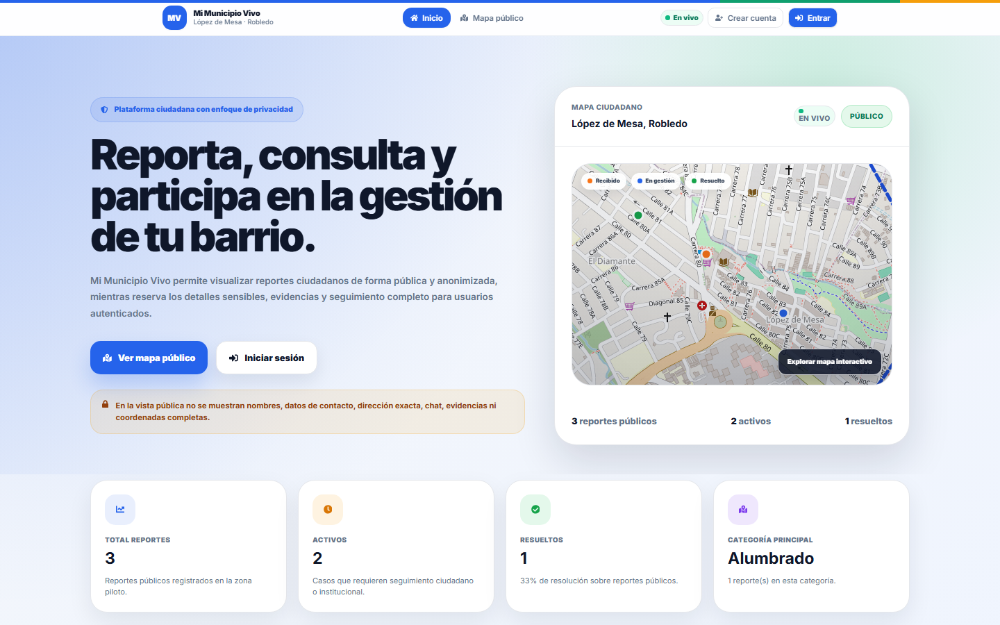
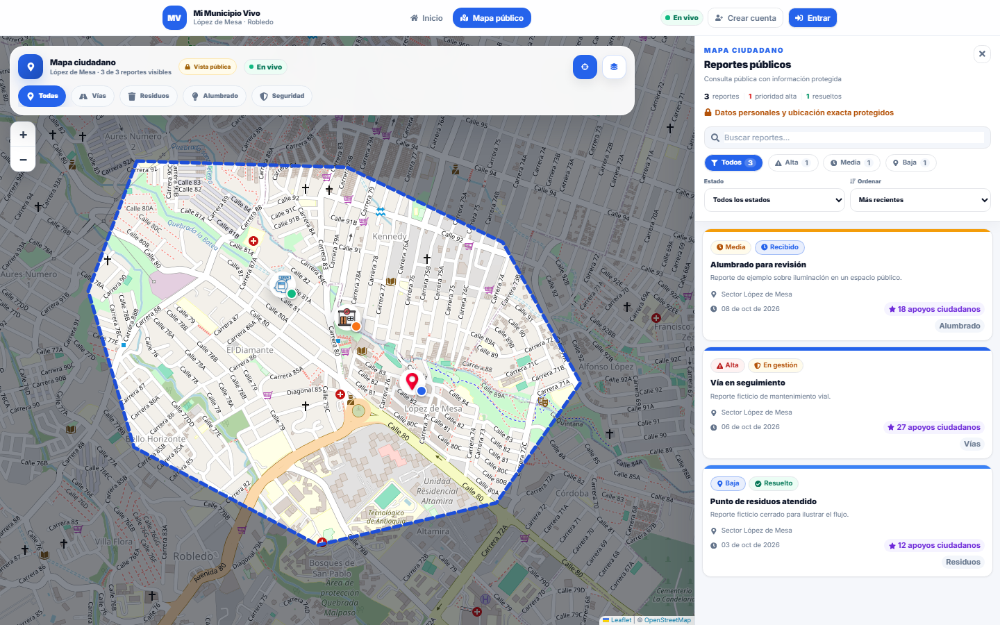
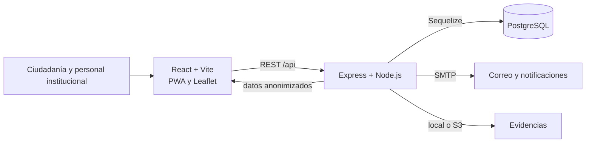

# Mi Municipio Vivo · caso de estudio

**Plataforma web de participación ciudadana para reportar y gestionar incidencias urbanas.** El piloto se centra en el barrio López de Mesa, Robledo, Medellín. Este repositorio presenta el producto, las decisiones técnicas y la interfaz pública; el código de la aplicación permanece en un repositorio privado.

> **Sobre las capturas:** se tomaron de la interfaz real ejecutada localmente, con respuestas de API y reportes ficticios preparados para esta presentación. No muestran personas, reportes ni métricas reales. No hay una demo pública activa.

## Interfaz pública

### Inicio y resumen de reportes

### Mapa ciudadano y filtros

Mapas y datos cartográficos: [© OpenStreetMap contributors](https://www.openstreetmap.org/copyright). Los puntos y las cifras en estas capturas son ficticios.

## Problema y enfoque

Los incidentes del barrio suelen quedar dispersos entre mensajes y canales informales. Mi Municipio Vivo propone un lugar común para registrar reportes, ver su estado y dar seguimiento a la gestión, con una vista pública que protege los detalles sensibles.

| Necesidad | Función de la plataforma |
| --- | --- |
| Ubicar y consultar incidentes | Mapa público con reportes georreferenciados de forma anonimizada |
| Registrar y seguir un caso | Reportes con evidencias, historial, estados y notificaciones |
| Coordinar la respuesta | Asignaciones, paneles institucionales y auditoría |
| Participar en la conversación | Chats vinculados a reportes, grupos y comunidades |
| Usar la aplicación desde móvil | Interfaz adaptable y PWA instalable |

## Arquitectura resumida

La aplicación separa la vista pública de las funciones autenticadas. La API utiliza JWT, roles y permisos por recurso; las migraciones administran el esquema de PostgreSQL. Consulta [las decisiones de arquitectura](docs/architecture.md) y [el enfoque de calidad](docs/quality.md).

## Mi trabajo en este proyecto

- Construcción de una interfaz React con mapa, filtros, paneles y estados de carga.
- Diseño de una API REST en Express con modelos Sequelize y PostgreSQL.
- Separación de datos públicos y privados, autenticación y control de acceso.
- Pruebas automatizadas para frontend, backend y flujos críticos de interfaz.
- Preparación de ejecución con Docker Compose y documentación de despliegue.

## Alcance de esta publicación

Este repositorio contiene **documentación y capturas**, no datos de producción ni el código fuente privado. Las plantillas de AWS del proyecto describen una ruta de despliegue; no significan que exista un servicio público activo.

**Autor:** [Yifer Andrés Perea Blandón](https://github.com/ImDogBvs) · estudiante de Ingeniería de Software en Medellín.
